  

<picture>
  <source media="(prefers-color-scheme: dark)" srcset="cards/languages-dark.svg" />
  
</picture>
<picture>
  <source media="(prefers-color-scheme: dark)" srcset="https://raw.githubusercontent.com/cgadde16/cgadde16/output/github-snake-dark.svg" />
  
</picture>
